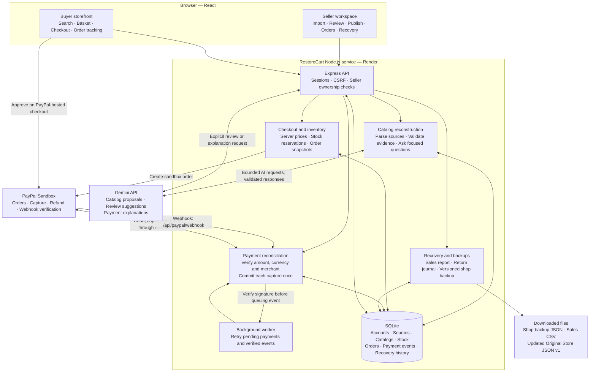

# RestoreCart — keep selling, bring every order back

RestoreCart reconstructs a catalog from surviving records, opens a temporary pickup storefront with PayPal sandbox checkout, and returns emergency sales through a duplicate-safe local recovery process. Detailed setup: [RESTORECART_README.md](RESTORECART_README.md).

## Architecture

RestoreCart is one application with separate seller and buyer views. React runs in the browser; an Express server handles authentication, Gemini requests, PayPal sandbox payments and SQLite storage. API keys stay on the server.



### End-to-end flow

```mermaid
sequenceDiagram
    autonumber
    actor Seller
    participant UI as RestoreCart browser
    participant Server as Express server
    participant AI as Gemini
    participant DB as SQLite
    actor Buyer
    participant PP as PayPal Sandbox

    Seller->>UI: Upload CSV, PDF or product images
    UI->>Server: Save source records
    Server->>DB: Store original evidence
    Seller->>UI: Import or review with Gemini
    UI->>Server: Request AI assistance
    Server->>AI: Sources and constrained instructions
    AI-->>Server: Product proposals, evidence and questions
    Server->>Server: Validate source references and supported values
    Server->>DB: Save draft or cache validated suggestions
    Server-->>UI: Show conflicts and missing information
    Seller->>UI: Confirm price, physical count, allocation and pickup details
    UI->>Server: Save reviewed products; publish shop
    Server->>DB: Save published catalog snapshot

    Buyer->>UI: Browse published products and add to basket
    UI->>Server: Checkout selected shop
    Server->>DB: Validate catalog, price order and reserve stock
    Server->>PP: Create sandbox order
    PP-->>UI: PayPal approval link
    Buyer->>PP: Approve sandbox checkout
    PP-->>UI: Return to receipt
    UI->>Server: Check order outcome
    Server->>PP: Verify order and request capture when approved
    alt Verified completed capture
        Server->>DB: Mark paid and commit stock movement once
    else Pending or uncertain payment
        Server->>DB: Keep payment checking and stock locked
        Note over Server,PP: Worker and verified webhooks reconcile the outcome
    end
    Server-->>UI: Return recorded payment and pickup status
    Seller->>Server: Mark paid order ready, then collected
    Server->>DB: Save pickup status
    UI->>Server: Buyer tracking polls for updates
    Server-->>UI: Preparing, ready for pickup or collected

    Seller->>Server: Stop new orders and resolve pending payments
    Server->>DB: Build immutable sales report
    Server-->>Seller: Download sales CSV
    Seller->>Server: Upload fresh Original Store JSON v1; compare return
    Server->>DB: Apply supported changes with duplicate-safe journal
    Server-->>Seller: Download updated original-store file
    Seller->>Server: Compare the same return again
    Server-->>Seller: No duplicate changes
```

The buyer approves payment on PayPal; RestoreCart verifies the outcome before marking an order paid. Gemini proposes and explains; it cannot confirm physical stock, publish products, mark payments paid or issue refunds. Seller actions and server validation control those transitions.

- **Shop backup:** saves catalog, evidence, images and shop details for a new unpublished draft or an isolated rehearsal. It excludes accounts, orders and payments; fresh stock confirmation is required after restoration.
- **Sales recovery:** returns recorded emergency sales, refunds and stock changes through the supported **local Original Store JSON v1 adapter**. It does not automatically update Shopify or WooCommerce, and applying a return does not charge a buyer again.
- **Demo boundary:** prepared records and simulated order-status cards are labelled examples. Simulated cards never enter payment, inventory or recovery records. Actual checkout uses PayPal sandbox. One configured sandbox merchant receives payments; independent seller payout onboarding is not implemented.
- **Hosting boundary:** SQLite requires persistent storage to retain accounts, uploads and orders across redeploys. The free Render configuration is ephemeral; see [deployment instructions](DEPLOY_RENDER.md).

## RestoreCart demo accounts (local practice)

These two accounts have been registered in the local RestoreCart database. Sign in with either the username or email.

| Role | Username | Email | Password | Sign-in page |
| --- | --- | --- | --- | --- |
| Seller | `demo-seller` | `seller.demo@restorecart.test` | `RestoreSeller2026!` | `/restorecart/seller/sign-in` |
| Buyer | `demo-buyer` | `buyer.demo@restorecart.test` | `RestoreBuyer2026!` | `/restorecart/account` |

They are public synthetic **RestoreCart app** credentials, not your PayPal sandbox credentials. Use them for local demonstration only. The seller has its own “Sunday Studio Demo” workspace with the example source records; it does not take ownership of earlier shops or orders. No public demo accounts are automatically created by the server.

```sh
npm run restorecart:demo-accounts
npm run dev:restorecart
```

The first command creates missing demo accounts in the current RestoreCart database and never resets an existing password. It refuses production mode. If starting with a fresh database, run it before the demo; copying the source repository alone does not copy account records. Hosted instances require separately registered accounts with private passwords. Registration is available on both sign-in pages and creates a separate seller workspace or a buyer account; it does not connect another merchant's PayPal account.

Start at [seller sign-in](http://127.0.0.1:4370/restorecart/seller/sign-in) or [buyer sign-in](http://127.0.0.1:4370/restorecart/account). One browser session signs in as one account at a time. To show both roles simultaneously, use separate browser profiles or a private window.

Buyers sign in once across every shop; no separate shop login is required. Saved items are grouped by seller for checkout. Buyer carts persist per shop and account across refresh/sign-out/sign-in, and a visitor's cart attaches when they register/sign in. After buyer sign-in, Explore products opens directly. The header basket icon shows the total item count across shops. Add items from product cards or use Add to basket below PayPal on a shop page; choosing quantities alone does not save them. The basket page supports quantity changes, removal, seller subtotals and separate seller checkouts. Your orders opens private purchase history. Quantities are checked against current stock; saving a cart does not reserve stock or freeze prices. Checkout still reserves and prices everything on the server.

## Seller interface

The seller workspace now has **Shop editor**, **Orders**, and **Recovery**. Upload/import and product confirmation share one editor; Gemini assists import, source review and payment explanations. Shop details remain manual. Own draft/published previews replace the buyer-side navigation link. Shop backup download/restore lives in the editor menu, and sales report download lives in Recovery. Gemini is persistently enabled in `restorecart.config.json`; routine tests remain fixtures and existing usage limits still apply.

## Recovery features in plain language

- **Recovery** is the closing workspace: close new checkouts, finish pending payment/refund checks, and prepare a final handoff.
- **Download sales report** downloads a readable CSV report derived from an immutable archive with orders, payments, stock movements and CSVs for inspection/manual import.
- **Update original-store records** is the optional actionable return inside that workspace. Upload a fresh **Original Store JSON v1** export, compare changes, resolve conflicts, apply to the local destination and download its updated file. Repeat comparison should show zero changes. This does not automatically write into Shopify/WooCommerce or charge the buyer again.
- **Shop backup** is a versioned catalog/source/image/shop-details snapshot for reopening later. An operational restore creates an unpublished draft requiring fresh counts and confirmations. A rehearsal is isolated and cannot publish or take payments. Its return simulation proves repeat safety without placing an order. Kits intentionally exclude orders, sessions, passwords and payment records.

RestoreCart Orders currently uses custom React cards. AG Studio and Bryntum are not used in this standalone repository.

Account passwords are stored with salted scrypt hashes; sessions use HTTP-only cookies and CSRF checks. Registered sellers can access only their own shops, sources, kits, orders and destinations. The configured workspace-owner login retains earlier unassigned shops. This prototype does not yet offer email verification, password recovery, independent merchant onboarding/payouts or production account administration.


## Standalone setup

Requires Node.js 24 or newer.

```sh
npm ci --include=dev
cp .env.example .env
# Enter your local credentials in .env.
npm run restorecart:demo-accounts
npm run dev
```

Open http://127.0.0.1:4370/restorecart. For checks, run `npm test` and `npm run build`. `npm start` always launches RestoreCart in production mode. It requires an HTTPS `RESTORECART_BASE_URL` and a private seller password.

See [Render deployment instructions](DEPLOY_RENDER.md) to deploy this repository. No private .env, account database, local merchant orders or API secrets are included. The demo preparation command creates synthetic accounts and a reviewable draft locally; it refuses production. Hosted accounts must be registered privately. Source separation preserves earlier development in the original [ScrapDrop repository](https://github.com/miko-keng/scrapdrop), extracted from commit 7ee04e3.
