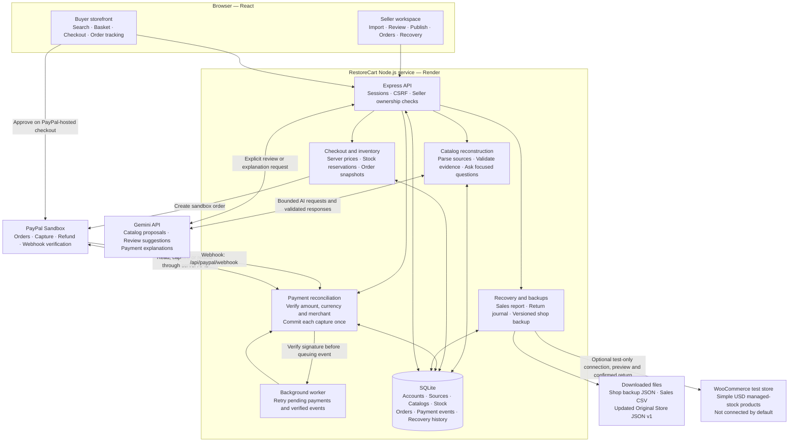
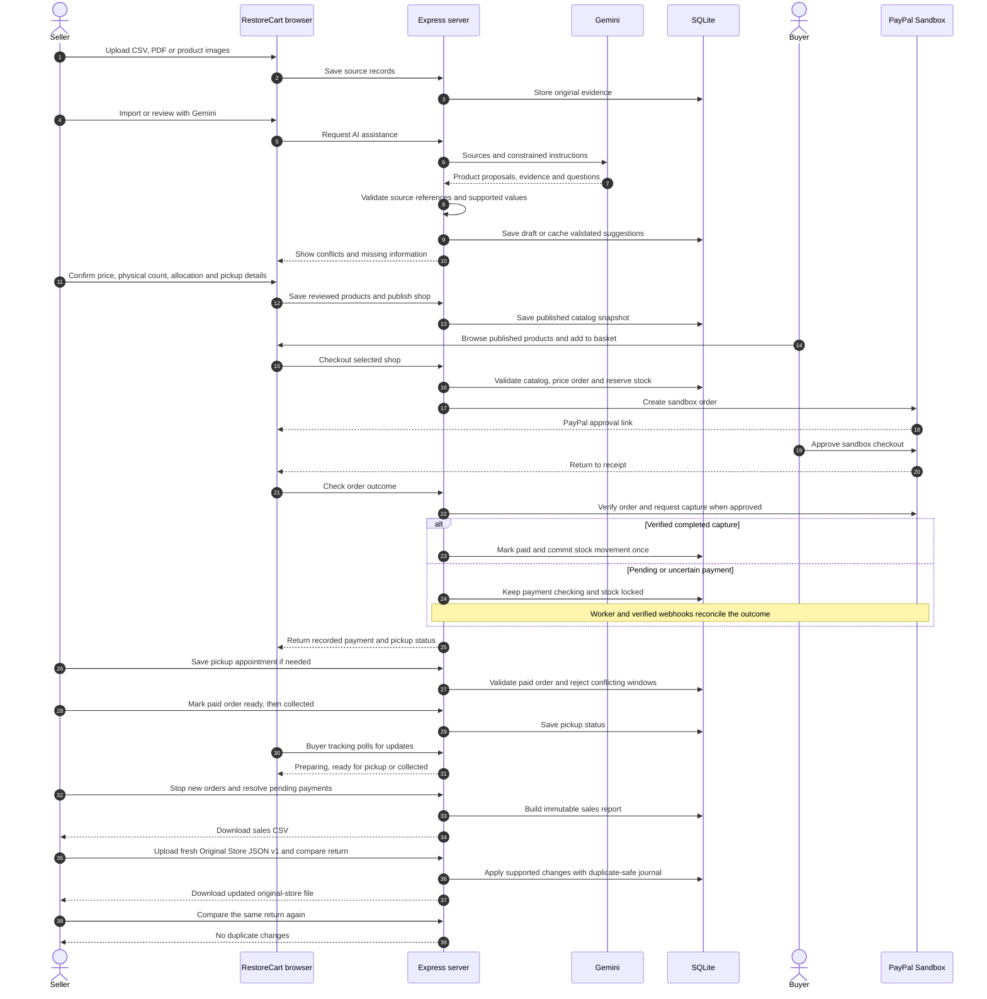

# RestoreCart — keep selling, bring every order back

RestoreCart reconstructs a catalog from surviving records, opens a temporary pickup storefront with PayPal sandbox checkout, and returns emergency sales through a duplicate-safe local recovery process. Detailed setup: [RESTORECART_README.md](RESTORECART_README.md).

[Hosted demo](https://restorecart.onrender.com/restorecart) · [Judge access](docs/restorecart/JUDGE_ACCESS.md) · [Three-minute recording guide](DEMO_REHEARSAL_GUIDE.md) · [Submission description](docs/restorecart/SUBMISSION_DESCRIPTION.md) · [Final release status](docs/restorecart/RELEASE_CHECKLIST.md)

## Reviewer guide: resettable sandbox demo and test evidence

**This submission is a sandbox prototype. The default Render Free deployment uses temporary local SQLite; persistent external storage is implemented but is not configured or hosted-restart verified.** New accounts, uploads, baskets, sandbox orders and recovery progress may be lost when the service spins down, restarts or redeploys. The application is not presented as a durable production order system.

| What a reviewer sees | Where it comes from | What a reset means |
| --- | --- | --- |
| Prepared Sunday Studio catalog and review draft | Preloaded sample records in the repository | Can be prepared again; prior seller changes are not guaranteed to survive |
| Sample preview order statuses and pickup appointments | UI-only simulated examples | Reappear from code; never affect PayPal totals, stock or recovery |
| A buyer's actual PayPal sandbox checkout | PayPal sandbox API plus RestoreCart's running database | The new app order can be lost after a hosting reset; the separate PayPal sandbox transaction is not erased |
| Seller fulfillment and duplicate-safe local-file recovery | Recorded orders and journals in the running database | Works while records are available; it does not recover a lost database from hardcoded examples |

Pushing this repository to GitHub preserves source code and sample fixtures, **not the running database**. Private operational databases and credentials are intentionally excluded. Shop backup downloads contain catalog/shop data, not orders or payment history.

### Evidence and how to reproduce it

- **Current automated verification:** 153 tests passed on 3 November 2026; production build passed. Run `npm ci --include=dev`, then `npm test`. These tests use fixtures/controlled payment transports; passing them is not a new live PayPal transaction or proof of persistent Render hosting. [Current verification and limitations](docs/restorecart/PAYPAL_SELLER_CONNECTION.md).
- **Historical real sandbox E2E:** the documented local run used live Gemini and a $52 PayPal sandbox capture, followed by fulfillment, backup restoration and duplicate-safe local recovery. The historical 84-test count belongs to that earlier run. [Recorded E2E report](docs/restorecart/FINAL_E2E_REPORT.md).
- **Local demonstration:** follow the [input/button rehearsal guide](DEMO_REHEARSAL_GUIDE.md) to show actual sandbox checkout, Orders, pickup tracking and recovery in one running session. Clearly identify Sample preview and saved Gemini replay. An edited demonstration should not imply simulated examples are actual payments.
- **Submission video:** final public video link is pending. The recording should show the local flow and disclose that the free hosted demo may reset. No claim is made here that an unlinked video has already been reviewed.
- **Current hosted verification:** implementation commit `85c9474` was deployed on 31 October 2026 and completed a real $52 PayPal sandbox capture, seller fulfillment, buyer pickup tracking and local-file recovery with zero repeat changes. [Hosted release report](docs/restorecart/HOSTED_RELEASE_REPORT.md). Webhook delivery was not independently observed in that journey; it used the verified server payment flow. A configuration redeploy also demonstrated loss of temporary app records, so no persistence claim is made.

WooCommerce is an optional seller-configured connector. Automated contract tests exist; real-store verification is pending. It is not required to run the supported local Original Store JSON v1 recovery demonstration. External Turso/libSQL storage can be configured later using the [setup and migration guide](docs/restorecart/EXTERNAL_STORAGE.md).

## Latest approved improvements

When deployed, the latest code recreates a labelled published **Sunday Studio Sample Shop** on an empty database, separately from the unresolved seller review draft. This is resettable sample data, not durable transaction storage. Gemini has renewable per-seller quotas, product drafts survive other-product saves, and payment checks expose redacted diagnostics.

[Earlier verification: 98 tests and browser checks](docs/restorecart/APPROVED_FIXES_TEST_REPORT.md) · [Changes and limits](docs/restorecart/APPROVED_FIXES.md) · [Optional WooCommerce test connector](docs/restorecart/WOOCOMMERCE_TEST_CONNECTOR.md) · [Merchant trial protocol](docs/restorecart/MERCHANT_TRIAL_GUIDE.md). WooCommerce is **Not connected** until configured; live integration remains unverified.

Saved Sunday Studio Gemini review can now be replayed with **zero API calls**, labelled with its original date. Order-status samples follow the selected filter. [Replay provenance and verification](docs/restorecart/SAVED_GEMINI_REVIEW.md).

## Seller PayPal connection

Open **Seller Settings → Connections → PayPal payments → Connect PayPal**. The seller signs in on PayPal and grants payment/refund permission; RestoreCart verifies the merchant and permissions server-side before enabling seller checkout. Orders retain their original merchant for capture and refund even if the shop later disconnects. No seller PayPal password or API secret is entered into RestoreCart.

**Activation is pending:** the current local configuration has single-merchant checkout credentials, but no platform merchant ID or attribution ID. The panel displays Not connected and explains that setup is unavailable. Configure a sandbox **Platform REST app** with Partner Referrals access to activate it. Sandbox testing can precede live partner approval; this app remains sandbox-only. [Setup, security checks and current verification](docs/restorecart/PAYPAL_SELLER_CONNECTION.md).

The existing single-account demo remains available when platform configuration is entirely absent; it is explicitly labelled as using a shared sandbox account. Valid platform configuration, strict mode, or any saved shop connection prevents an unconnected shop from silently falling back to that account. Historical shared-account orders are not migrated to another merchant by connecting a seller.

## Order operations, decision history and pickup scheduling

The core import → review → publish → checkout → recovery flow stays the same. These improvements add operational controls without requiring a new recording of that flow.

| Improvement | How to use it |
| --- | --- |
| Seller decision history | Use a field-level suggestion or choose **Keep current value**, then save the product. Expand **Seller decision history** to see accepted, rejected or overridden suggestions, final values, supporting source hashes, seller and timestamp. Clicking alone does not record a saved decision. |
| AG Grid order workspace | In Orders → Order table, choose All, Needs attention, To prepare or Unscheduled pickups. Search and filter amounts in USD. The captured/refunded/net totals follow the visible rows; export filtered CSV or reset the table. Table preferences survive navigation in the same browser session. |
| Bryntum pickup planning | In Orders → Pickup schedule, save opening dates, find the next available slot and confirm it. Dragging an eligible appointment proposes a change; **Confirm appointment** saves it. Keyboard-accessible forms provide the same rescheduling path. Click an appointment to open its order. |
| Payment and stock safeguards | Server checks reject overlapping appointments, outdated edits and ineligible orders. Buyer receipts show saved pickup changes. Concurrent checkout, repeated capture/refund notifications and interrupted refunds have automated regression coverage. |

The schedule supports one counter and one opening window per date, in a fixed shop time zone. Dates crossing midnight are not supported. Sample orders remain separate, read-only examples and never change payments, stock or recovery. AG Grid uses Community features; AG Studio is not required. Bryntum remains an optional evaluation dependency with an appointment-list fallback; see [setup and licensing limits](docs/restorecart/BRYNTUM_SETUP.md).

Decision history is append-only through the application and shows the latest 100 entries for a product. It shares the database's retention limits: temporary hosted storage can lose history on restart. It is not a tamper-proof external audit service.

Run `npm test` for the full suite, `npm run test:ai-evals` for six focused AI validation scenarios, and `npm run build` for production checks. AI evaluations use controlled responses to test conflict handling, missing information, ambiguous photos, invented citations and document prompt injection. They do not measure fresh Gemini model accuracy and make no model API calls. [Results, browser evidence and limitations](docs/restorecart/PRIORITIES_12367_REPORT.md).

## Architecture

RestoreCart is one application with separate seller and buyer views. React runs in the browser; an Express server handles authentication, Gemini requests, PayPal sandbox payments and SQLite storage. API keys stay on the server.



### End-to-end flow



The buyer approves payment on PayPal; RestoreCart verifies the outcome before marking an order paid. Gemini proposes and explains; it cannot confirm physical stock, publish products, mark payments paid or issue refunds. Seller actions and server validation control those transitions.

- **Shop backup:** saves catalog, evidence, images and shop details for a new unpublished draft or an isolated rehearsal. It excludes accounts, orders and payments; fresh stock confirmation is required after restoration.
- **Sales recovery:** returns recorded emergency sales, refunds and stock changes through the supported **local Original Store JSON v1 adapter**. The local adapter does not update Shopify or WooCommerce. A separate optional WooCommerce test connector previews and returns supported simple-product sales after connection and confirmation; it does not charge a buyer again.
- **Demo boundary:** prepared records and simulated order-status cards are labelled examples. Simulated cards never enter payment, inventory or recovery records. Actual checkout uses PayPal sandbox. One configured sandbox merchant receives payments; independent seller payout onboarding is not implemented.
- **Hosting boundary:** SQLite requires persistent storage to retain accounts, uploads and orders across redeploys. The free Render configuration is ephemeral; see [deployment instructions](DEPLOY_RENDER.md).

## Demo verification and rehearsal

The earlier documented local seller/buyer E2E run used live Gemini review and one real PayPal sandbox capture ($52 test funds), then verified pickup tracking, backup restoration and zero-duplicate recovery. At that milestone, 84 automated tests and the production build passed. The current automated suite contains 153 tests; see the reviewer guide above. [Read the scoped test report](docs/restorecart/FINAL_E2E_REPORT.md) and [follow the exact input/button guide](DEMO_REHEARSAL_GUIDE.md). For the newer hosted verification, see the [hosted release report](docs/restorecart/HOSTED_RELEASE_REPORT.md); independent hosted webhook delivery remains unverified.

## RestoreCart demo accounts (local practice)

These two accounts have been registered in the local RestoreCart database. Sign in with either the username or email.

| Role   | Username      | Email                          | Password             | Sign-in page                  |
| ------ | ------------- | ------------------------------ | -------------------- | ----------------------------- |
| Seller | `demo-seller` | `seller.demo@restorecart.test` | `RestoreSeller2026!` | `/restorecart/seller/sign-in` |
| Buyer  | `demo-buyer`  | `buyer.demo@restorecart.test`  | `RestoreBuyer2026!`  | `/restorecart/account`        |

They are public synthetic **RestoreCart app** credentials, not your PayPal sandbox credentials. Use them for local demonstration only. The seller has its own “Sunday Studio Demo” workspace with the example source records; it does not take ownership of earlier shops or orders. No public demo accounts are automatically created by the server. The configured seller receives a prepared Sunday Studio Demo draft when their workspace is empty; registered sellers can use **Load prepared Sunday Studio Demo** to create their own isolated copy.

```sh
npm run restorecart:demo-accounts
npm run dev:restorecart
```

The first command creates missing demo accounts in the current RestoreCart database and never resets an existing password. It refuses production mode. If starting with a fresh database, run it before the demo; copying the source repository alone does not copy account records. Hosted instances require separately registered accounts with private passwords. Registration is available on both sign-in pages and creates a separate seller workspace or a buyer account; it does not connect another merchant's PayPal account.

Start at [seller sign-in](http://127.0.0.1:4370/restorecart/seller/sign-in) or [buyer sign-in](http://127.0.0.1:4370/restorecart/account). One browser session signs in as one account at a time. To show both roles simultaneously, use separate browser profiles or a private window.

Buyers sign in once across every shop; no separate shop login is required. Saved items are grouped by seller for checkout. Buyer carts persist per shop and account across refresh/sign-out/sign-in, and a visitor's cart attaches when they register/sign in. After buyer sign-in, Explore products opens directly. The header basket icon shows the total item count across shops. Add items from product cards or use Add to basket below PayPal on a shop page; choosing quantities alone does not save them. The basket page supports quantity changes, removal, seller subtotals and separate seller checkouts. Your orders opens private purchase history. Quantities are checked against current stock; saving a cart does not reserve stock or freeze prices. Checkout still reserves and prices everything on the server.

## Seller interface

The seller workspace has **Shop editor**, **Orders**, **Recovery**, and secondary **Settings**. **Load prepared Sunday Studio Demo** works after hosted sign-in without public demo passwords, uploading files or re-entering shop details. Review remains unfinished for your demonstration. Upload/import and product confirmation share one editor; Gemini assists import, source review and payment explanations. Shop details remain manual. Own draft/published previews replace the buyer-side navigation link. Shop backup download/restore and optional store connections live in Settings, and sales report download lives in Recovery. Gemini is persistently enabled in `restorecart.config.json`; routine tests remain fixtures and existing usage limits still apply.

## Recovery features in plain language

- **Recovery** is the closing workspace: close new checkouts, finish pending payment/refund checks, and prepare a final handoff.
- **Download sales report** downloads a readable CSV report derived from an immutable archive with orders, payments, stock movements and CSVs for inspection/manual import.
- **Update original-store records** is the optional actionable return inside that workspace. Upload a fresh **Original Store JSON v1** export, compare changes, resolve conflicts, apply to the local destination and download its updated file. Repeat comparison should show zero changes. This does not automatically write into Shopify/WooCommerce or charge the buyer again.
- **Shop backup** is a versioned catalog/source/image/shop-details snapshot for reopening later. An operational restore creates an unpublished draft requiring fresh counts and confirmations. A rehearsal is isolated and cannot publish or take payments. Its return simulation proves repeat safety without placing an order. Kits intentionally exclude orders, sessions, passwords and payment records.

RestoreCart Orders offers custom React cards and an AG Grid Community table with sorting, column filters, quick search and order actions. A pickup appointment list is always available; the Bryntum Scheduler Pro evaluation timeline is optional and enabled locally for evaluation. Set `VITE_ENABLE_BRYNTUM=true` at build time only when your terms cover the hosted demo. AG Studio is a different product and is not used here; its licence is not required for AG Grid Community.

Account passwords are stored with salted scrypt hashes; sessions use HTTP-only cookies and CSRF checks. Registered sellers can access only their own shops, sources, kits, orders and destinations. The configured workspace-owner login retains earlier unassigned shops. This prototype does not yet offer email verification, password recovery, independent merchant onboarding/payouts or production account administration.

## Standalone setup

Requires Node.js 24 or newer.

```sh
npm ci --include=dev
cp .env.example .env
# Enter your local credentials in .env.
npm run restorecart:demo-accounts
npm run dev
```

Open http://127.0.0.1:4370/restorecart. For checks, run `npm test` and `npm run build`. `npm start` always launches RestoreCart in production mode. It requires an HTTPS `RESTORECART_BASE_URL` and a private seller password.

See [Render deployment instructions](DEPLOY_RENDER.md) to deploy this repository. No private .env, account database, local merchant orders or API secrets are included. The demo preparation command creates synthetic accounts and a reviewable draft locally; it refuses production. Hosted accounts must be registered privately. Source separation preserves earlier development in the original [ScrapDrop repository](https://github.com/miko-keng/scrapdrop), extracted from commit 7ee04e3.

## Hosted demo and order workspace

After deploying the latest `main`, sign in with the hosted seller credentials configured in Render. An empty configured workspace receives **Sunday Studio Demo** automatically. Other registered sellers can click **Load prepared Sunday Studio Demo**. This authenticated, CSRF-protected setup preserves existing shop reviews, publication and sales. It creates sample records and shop details, not fabricated paid orders or public credentials.

Under **Orders**, select **Sample preview** for six clearly labelled simulated order statuses. The desktop table, mobile cards and pickup schedule share these UI-only examples. They never enter actual order storage, inventory changes, payment totals or recovery exports.

Switch to **Actual sandbox orders** for buyer purchases. Desktop uses AG Grid Community with sorting, filters and Open order; narrow screens use cards. Pickup schedule displays seller-saved appointments for eligible paid orders; a plain list is always available. The optional Bryntum evaluation timeline requires `VITE_ENABLE_BRYNTUM=true` and applicable evaluation/deployment rights. Sample appointments are illustrative, not actual buyer bookings.

See [migration audit and verification](docs/restorecart/HOSTED_DEMO_AND_ORDERS.md) for the extraction check and limitations.


### External persistence and WooCommerce readiness

Free Render compute can use the optional Turso/libSQL adapter. Accounts, binary source uploads, receipts, payment reconciliation and recovery journals are stored directly in the configured remote database. See [setup and guarded migration](docs/restorecart/EXTERNAL_STORAGE.md). Local SQLite remains the development default; external credentials and a hosted restart test are still required. The prototype synchronously waits for SQL worker replies, so remote latency can block other requests; load testing is pending.

WooCommerce Settings lets each seller enter a public root HTTPS test-store URL and private credentials without per-store operator approval (one server-side encryption key must be configured). Connection testing is read-only; recovery preview and confirmed return are separate actions. [Connection setup and supported scope](docs/restorecart/WOOCOMMERCE_TEST_CONNECTOR.md). Automated tests cover uncertain outcomes and duplicate-safe restart recovery. **A real WooCommerce test store and live connector verification are still pending.** No payment is collected again during return.

## Final self-service and recovery polish — 1 November 2026

In **Settings → Connections**, a visible **WooCommerce** card shows **Not connected** and **Connect store**. Clicking it opens Store URL, consumer key, consumer secret, a test-store confirmation and **Connect / Cancel**. API-key help and supported-use details stay collapsed. Connection checks only read products/orders; credentials are encrypted server-side. No operator needs to approve each shop. One deployment encryption key is required before saving any connections. Private-network targets, redirects and oversized/slow responses are blocked; connection attempts are limited. [Scope and security checks](docs/restorecart/WOOCOMMERCE_TEST_CONNECTOR.md). Real-store recovery is still unverified.

Local recovery now shows returned orders, stock changes, recorded captured/refunded/net amounts, and a **Return verified** result only after a repeat comparison finds no changes. These numbers come from retained orders and inventory events, not hardcoded demo totals. Technical changes are expandable. This proves updating the supported local JSON file; it does not claim an automatic WooCommerce return.

Final verification and submission handoff: [test evidence](docs/restorecart/FINAL_SELF_SERVICE_REPORT.md), [submission checklist and judging evidence](docs/restorecart/SUBMISSION_HANDOFF.md), [updated 2:55 recording script](DEMO_REHEARSAL_GUIDE.md). New local verification is separate from the historical hosted $52 transaction. The public video still needs to be recorded, uploaded and linked.

### WooCommerce connection entry

1. Sign in as a seller and select the rescue shop.
2. Open **Settings → Connections → WooCommerce → Connect store**.
3. Enter the public HTTPS store URL, consumer key and consumer secret.
4. Confirm test-store use, then choose **Connect**. This checks read access before saving credentials encrypted on the server.

The card changes to **Connected** only after a successful connection check. Recovery preview and confirmed return are separate actions. The server needs `WOOCOMMERCE_ENCRYPTION_KEY` configured privately once; this key is not included in GitHub. No per-store operator approval is required.


