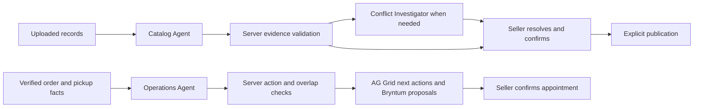
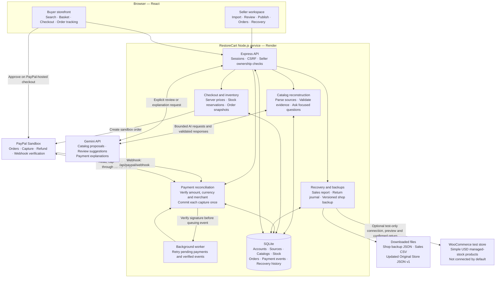
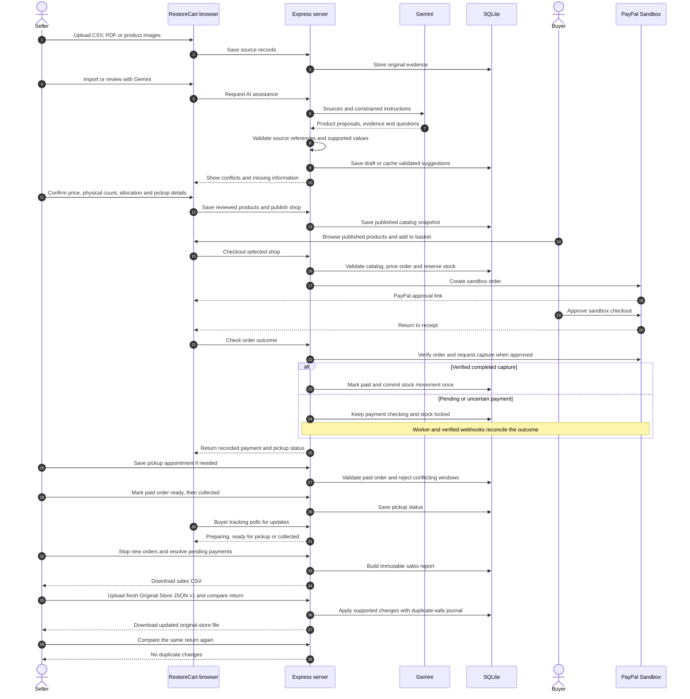
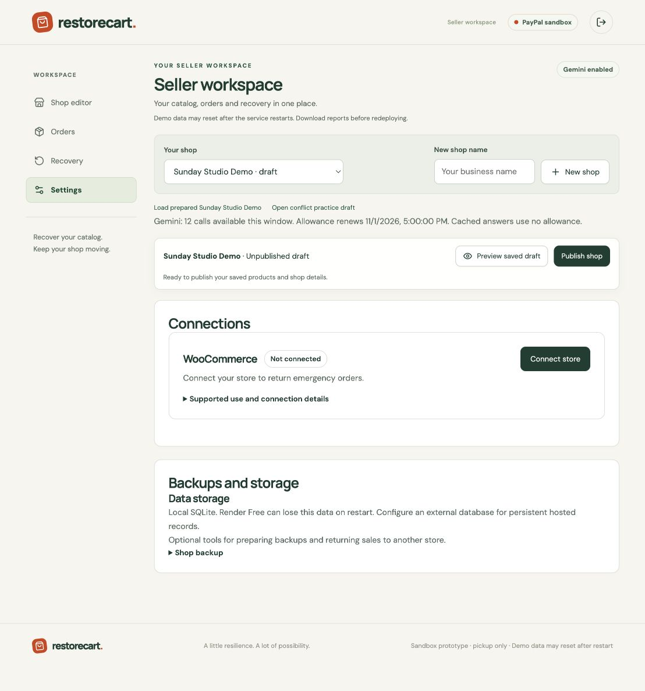

# RestoreCart — keep selling, bring every order back

RestoreCart reconstructs a catalog from surviving records, opens a temporary pickup storefront with PayPal sandbox checkout, and returns emergency sales through a duplicate-safe local recovery process. Detailed setup: [RESTORECART_README.md](RESTORECART_README.md).

[Hosted demo](https://restorecart.onrender.com/restorecart) · [Judge access](docs/restorecart/JUDGE_ACCESS.md) · [Simple recording guide](docs/restorecart/RECORDED_SUBMISSION_GUIDE.md) · [Submission description](docs/restorecart/SUBMISSION_DESCRIPTION.md) · [Final release status](docs/restorecart/RELEASE_CHECKLIST.md)

## Try the demo without a purchase

Sign in as the configured seller (`workspace-owner`) and select **Sunday Studio Demo** in **Shop editor**. See the [seller sign-in details](#restorecart-demo-accounts-local-practice). If it is missing, open **Shop options → Load prepared Sunday Studio Demo**. Click **Open AI review** to replay the saved Gemini response without a new API call. Use **Review next** or a product’s **Review** button to open its details, check the source prices and confirm stock. **Preview** and **Publish** stay in the editor.

For the order demo, go to **Orders → Sample orders → Assistant → Play demo chat**. Try **Approve** or **Reject** on the $20 Blue mug example. Sample actions never affect payments, inventory or recovery reports. **Sandbox orders** shows orders placed through test checkout. Open an order to see its payment history and pickup details.

Use the [simple recording guide](docs/restorecart/RECORDED_SUBMISSION_GUIDE.md) for the seller-only video, or the [full-transaction rehearsal](DEMO_REHEARSAL_GUIDE.md) to test checkout and recovery.

## PayPal seller-account limitation — current demo

**In Shared demo mode, every completed sandbox checkout pays ONE configured PayPal sandbox business account, regardless of which RestoreCart seller or shop created the order.** Creating a RestoreCart seller account does not create or connect a separate PayPal account. Payments are not distributed to individual sellers, and this demo does not implement seller payouts. Sandbox transactions use test funds; no real money moves.

The **Connect PayPal** implementation can start a genuine sandbox authorization flow, but individual seller onboarding has **not been verified end to end**. Our attempt reached PayPal’s seller identity-information screen and was stopped without entering real ID details. Do not describe the current demo as verified multi-seller payment routing or production-ready merchant onboarding.

The selected fallback is explicitly labelled **Shared demo** in Settings and in the buyer basket. Seller-connected mode remains a separate configuration that requires verified seller authorization; it must not silently fall back to the shared account. Completing and validating separate seller connections is required before claiming each seller receives payments directly. The local fallback was verified; a source push alone does not prove the hosted service has adopted the same environment settings.

See [seller payment setup and verification limits](docs/restorecart/SELLER_PAYMENTS_UI.md).

## Reviewer guide: resettable sandbox demo

**The current Render deployment uses temporary local SQLite, by explicit demo scope.** Prepared products and sample statuses can be recreated from code. New accounts, actual orders, stock movements and recovery journals can disappear after a restart, redeploy or spin-down. GitHub does not preserve the running database. Download reports before redeploying; complete purchase and recovery in the same running session.

A Turso migration and hosted restart test passed on 4 November, but that connection was subsequently removed. Its reports remain historical evidence of the optional adapter, not a claim about the current deployment. [Current agent/backend report](docs/restorecart/AGENT_IMPLEMENTATION_REPORT.md).

| What a reviewer sees | Where it comes from | Storage behavior |
| --- | --- | --- |
| Prepared Sunday Studio catalog and review draft | Sample source records plus saved seller edits | Resettable SQLite records; fixtures can seed an empty database |
| Sample order statuses and pickup appointments | UI-only simulated examples | Reappear from code; never affect PayPal totals, stock or recovery |
| A buyer's actual PayPal sandbox checkout | PayPal sandbox API plus RestoreCart's database | New app records are temporary; PayPal retains its own sandbox transaction |
| Seller fulfillment and duplicate-safe local-file recovery | Recorded orders and recovery journals | SQLite journal prevents duplicates while retained; reset loses that journal |


Pushing this repository to GitHub preserves source code and sample fixtures, **not the running database**. Private operational databases and credentials are intentionally excluded. Shop backup downloads contain catalog/shop data, not orders or payment history.

### Evidence and how to reproduce it

- **Current automated verification:** 200 tests and the production build passed for the 7 November 2026 seller workspace update. Desktop and mobile browser checks covered the editor and sample Orders flow. Run `npm ci --include=dev`, then `npm test`. These tests use fixtures/controlled payment transports; passing them is not a new live PayPal transaction or proof of persistent Render hosting. [Current backend verification and measured AI results](docs/restorecart/BACKEND_VERIFICATION_2026_11.md).
- **Historical real sandbox E2E:** the documented local run used live Gemini and a $52 PayPal sandbox capture, followed by fulfillment, backup restoration and duplicate-safe local recovery. The historical 84-test count belongs to that earlier run. [Recorded E2E report](docs/restorecart/FINAL_E2E_REPORT.md).
- **Local demonstration:** follow the [input/button rehearsal guide](DEMO_REHEARSAL_GUIDE.md) to show actual sandbox checkout, Orders, pickup tracking and recovery in one running session. Clearly identify Sample orders and saved Gemini replay. An edited demonstration should not imply simulated examples are actual payments.
- **Submission video:** final public video link is pending. The recording should show the working flow and distinguish sample statuses, saved AI replay and actual sandbox purchases. No claim is made here that an unlinked video has already been reviewed.
- **Historical hosted checkout verification:** implementation commit `85c9474` was deployed on 31 October 2026 and completed a real $52 PayPal sandbox capture, seller fulfillment, buyer pickup tracking and local-file recovery with zero repeat changes. [Hosted release report](docs/restorecart/HOSTED_RELEASE_REPORT.md). Webhook delivery was not independently observed in that journey; it used the verified server payment flow. That earlier deployment used temporary storage. The separate 4 November Turso/restart verification is historical; current hosting again uses temporary SQLite.

WooCommerce is an optional seller-configured connector. Automated contract tests exist; real-store verification is pending. It is not required to run the supported local Original Store JSON v1 recovery demonstration. The optional Turso/libSQL adapter remains available through the [setup and migration guide](docs/restorecart/EXTERNAL_STORAGE.md), but is not active in the current deployment.

## Latest approved improvements

When deployed, the latest code recreates a labelled published **Sunday Studio Sample Shop** on an empty database, separately from the unresolved seller review draft. This is resettable sample data, not durable transaction storage. Gemini has renewable per-seller quotas, product drafts survive other-product saves, and payment checks expose redacted diagnostics.

[Earlier verification: 98 tests and browser checks](docs/restorecart/APPROVED_FIXES_TEST_REPORT.md) · [Changes and limits](docs/restorecart/APPROVED_FIXES.md) · [Optional WooCommerce test connector](docs/restorecart/WOOCOMMERCE_TEST_CONNECTOR.md) · [Merchant trial protocol](docs/restorecart/MERCHANT_TRIAL_GUIDE.md). WooCommerce is **Not connected** until configured; live integration remains unverified.

The Sunday Studio AI review has one **Saved response** badge. Its original date and model are under **Details**. Opening it makes **zero API calls**. [Replay provenance and verification](docs/restorecart/SAVED_GEMINI_REVIEW.md).

## Evidence verification and persistent storage

The backend now checks claims against the correct SKU record, withholds unsupported descriptions and photo certainty, preserves blocked decisions during saved replay, and rejects cross-variant spreadsheet values. A separately instructed Gemini checker has been evaluated on actual API calls; it remains **off by default** because the live producer comparison did not demonstrate an additional error caught. Server checks stay active with no extra AI call. [Measured comparison, safeguards, setup and limitations](docs/restorecart/BACKEND_VERIFICATION_2026_11.md).

Historical 4 November check, before disconnecting Turso: the local rehearsal data was preserved and migrated: all 24 original rows across 16 tables were compared unchanged. Separate application processes retained controlled order records, account/image data and recovery history; repeated recovery applied zero new changes. These are actual remote-database checks using controlled payment references. The hosted session, account and controlled order also survived an actual Render restart. [Persistence evidence](tests/evidence/restorecart-turso-persistence.json).

## Three specialized Gemini roles

The coordinator conditionally hands work between three roles using one Gemini provider and key. **Catalog Agent** reads uploaded evidence and proposes products. **Conflict Investigator** inspects unresolved SKU records and asks targeted questions. **Operations Agent** inspects recorded orders and proposes allowed next actions and pickup slots. They run within bounded requests, rather than simultaneously on every click.

Server evidence checks, verified payment state, availability constraints and seller approval remain authoritative. Agents cannot publish, confirm physical stock, charge/refund or save appointments. The separate general-purpose second checker remains off; the specialized Conflict Investigator is an active, different workflow. A seller edit updates readiness without spending another model call. Each run records role, version, tool outcomes, usage and timing; owner-protected history excludes private reasoning.



In **Orders → Sandbox orders**, open **Assistant**. Type an order question or choose **Review orders** / **Plan pickups**. Each recommendation shows the order, verified facts and **Approve / Reject** buttons. Approving a pickup saves its exact proposed time after current server checks; other approvals open the order so the seller can complete the task. Rejection records a dismissal. Default grid advice is deterministic. In **Pickup schedule**, save opening dates, then **Suggest pickup plan with Gemini** → **Review appointment** → **Confirm appointment**. Blue timeline events are unsaved proposals. The server computes times and rejects stale or overlapping changes; buyers see only saved appointments. Sample orders and the saved demo chat make no AI calls. Its isolated preparation walkthrough supports local Approve / Reject practice; see [recording and reliability notes](docs/restorecart/SAMPLE_CHAT_AND_RELIABILITY.md).

[Implementation, tools and measured checks](docs/restorecart/AGENT_IMPLEMENTATION_REPORT.md) · [Controlled agent tests](tests/restorecart-agents.test.ts) · [Actual Gemini evaluation](tests/evidence/restorecart-live-agents.json).

## Seller PayPal connection

Open **Seller Settings → Connections → PayPal payments → Connect PayPal**. The seller signs in on PayPal and grants payment/refund permission; RestoreCart verifies the merchant and permissions server-side before enabling seller checkout. Orders retain their original merchant for capture and refund even if the shop later disconnects. No seller PayPal password or API secret is entered into RestoreCart.

**Configuration:** the demonstration uses single-merchant checkout credentials. Separate private sandbox Platform verification settings have passed app authentication and an initial partner lookup; deployment-specific configuration determines whether seller connections are available. Use a sandbox **Platform REST app** with Partner Referrals access for seller onboarding. Sandbox testing can precede live partner approval; this app remains sandbox-only. [Setup, security checks and current verification](docs/restorecart/PAYPAL_SELLER_CONNECTION.md).

The existing single-account demo remains available when platform configuration is entirely absent; it is explicitly labelled as using a shared sandbox account. Valid platform configuration, strict mode, or any saved shop connection prevents an unconnected shop from silently falling back to that account. Historical shared-account orders are not migrated to another merchant by connecting a seller.

## Order operations, decision history and pickup scheduling

The core import → review → publish → checkout → recovery flow stays the same. These improvements add operational controls without requiring a new recording of that flow.

| Improvement | How to use it |
| --- | --- |
| Seller decision history | Use a field-level suggestion or choose **Keep current value**, then save the product. Expand **Seller decision history** to see accepted, rejected or overridden suggestions, final values, supporting source hashes, seller and timestamp. Clicking alone does not record a saved decision. |
| AG Grid order workspace | In Orders, use search, the status filter or the Table / Pickup schedule selector. The table shows Order, Items, Status, Next action and Total. Open Table options for CSV export or extra financial and pickup columns. |
| Bryntum pickup planning | In Orders → Pickup schedule, save opening dates, find the next available slot and confirm it. Dragging an eligible appointment proposes a change; **Confirm appointment** saves it. Keyboard-accessible forms provide the same rescheduling path. Click an appointment to open its order. |
| Payment and stock safeguards | Server checks reject overlapping appointments, outdated edits and ineligible orders. Buyer receipts show saved pickup changes. Concurrent checkout, repeated capture/refund notifications and interrupted refunds have automated regression coverage. |

The schedule supports one counter and one opening window per date, in a fixed shop time zone. Dates crossing midnight are not supported. Sample orders remain separate, read-only examples and never change payments, stock or recovery. AG Grid uses Community features; AG Studio is not required. Bryntum remains an optional evaluation dependency with an appointment-list fallback; see [setup and licensing limits](docs/restorecart/BRYNTUM_SETUP.md).

Decision history is append-only through the application and shows the latest 100 entries for a product. It shares the database's retention limits: temporary hosted storage can lose history on restart. It is not a tamper-proof external audit service.

Run `npm test` for the full suite, `npm run test:ai-evals` for six focused AI validation scenarios, and `npm run build` for production checks. The six routine AI evaluations use controlled responses to test conflict handling, missing information, ambiguous photos, invented citations and document prompt injection. Separate opt-in live Gemini comparisons and measured results are documented in the backend verification report; routine tests make no model API calls. [Results, browser evidence and limitations](docs/restorecart/PRIORITIES_12367_REPORT.md).

## Architecture

RestoreCart is one application with separate seller and buyer views. React runs in the browser; an Express server handles authentication, Gemini requests, PayPal sandbox payments and SQLite storage. API keys stay on the server.



### End-to-end flow



The buyer approves payment on PayPal; RestoreCart verifies the outcome before marking an order paid. Gemini proposes and explains; it cannot confirm physical stock, publish products, mark payments paid or issue refunds. Seller actions and server validation control those transitions.

- **Shop backup:** saves catalog, evidence, images and shop details for a new unpublished draft or an isolated rehearsal. It excludes accounts, orders and payments; fresh stock confirmation is required after restoration.
- **Sales recovery:** returns recorded emergency sales, refunds and stock changes through the supported **local Original Store JSON v1 adapter**. The local adapter does not update Shopify or WooCommerce. A separate optional WooCommerce test connector previews and returns supported simple-product sales after connection and confirmation; it does not charge a buyer again.
- **Demo boundary:** prepared records and simulated order-status cards are labelled examples. Simulated cards never enter payment, inventory or recovery records. Actual checkout uses PayPal sandbox. In Shared demo mode, one configured sandbox business account receives all test payments. Individual seller onboarding has not been verified end to end.
- **Hosting boundary:** SQLite requires persistent storage to retain accounts, uploads and orders across redeploys. The free Render configuration is ephemeral; see [deployment instructions](DEPLOY_RENDER.md).

## Demo verification and rehearsal

The earlier documented local seller/buyer E2E run used live Gemini review and one real PayPal sandbox capture ($52 test funds), then verified pickup tracking, backup restoration and zero-duplicate recovery. At that milestone, 84 automated tests and the production build passed. See the reviewer guide above for current verification. [Read the scoped test report](docs/restorecart/FINAL_E2E_REPORT.md) and [follow the exact input/button guide](DEMO_REHEARSAL_GUIDE.md). For the newer hosted verification, see the [hosted release report](docs/restorecart/HOSTED_RELEASE_REPORT.md); independent hosted webhook delivery remains unverified.

## RestoreCart demo accounts (local practice)

**To manage the preloaded shops**, sign in at `/restorecart/seller/sign-in` using the configured seller email and password (`RESTORECART_SELLER_EMAIL` and `RESTORECART_SELLER_PASSWORD`). This account appears as `workspace-owner` and owns **Sunday Studio Sample Shop** and the preloaded **Sunday Studio Demo** draft when those shops are present. **Shop editor** lists the shops owned by the signed-in seller.

**To create separate practice accounts**, run `npm run restorecart:demo-accounts` against the same local database your server uses. Then sign in with the username or email below.

| Role   | Username      | Email                          | Password             | Sign-in page                  |
| ------ | ------------- | ------------------------------ | -------------------- | ----------------------------- |
| Seller | `demo-seller` | `seller.demo@restorecart.test` | `RestoreSeller2026!` | `/restorecart/seller/sign-in` |
| Buyer  | `demo-buyer`  | `buyer.demo@restorecart.test`  | `RestoreBuyer2026!`  | `/restorecart/account`        |

These credentials are for local RestoreCart practice. The seeder prepares a separate **Sunday Studio Demo** draft for `demo-seller`. Other registered sellers can use **Shop options → Load prepared Sunday Studio Demo** to create a draft in their own workspace.

```sh
npm run restorecart:demo-accounts
npm run dev:restorecart
```

The seeder creates missing accounts in the selected local database and preserves existing passwords. For a hosted demo, use the configured seller credentials or register a private practice account.

Start at [seller sign-in](http://127.0.0.1:4370/restorecart/seller/sign-in) or [buyer sign-in](http://127.0.0.1:4370/restorecart/account). One browser session signs in as one account at a time. To show both roles simultaneously, use separate browser profiles or a private window.

Buyers sign in once across every shop; no separate shop login is required. Saved items are grouped by seller for checkout. Buyer carts persist per shop and account across refresh/sign-out/sign-in, and a visitor's cart attaches when they register/sign in. After buyer sign-in, Explore products opens directly. The header basket icon shows the total item count across shops. Add items from product cards or use Add to basket below PayPal on a shop page; choosing quantities alone does not save them. The basket page supports quantity changes, removal, seller subtotals and separate seller checkouts. Your orders opens private purchase history. Quantities are checked against current stock; saving a cart does not reserve stock or freeze prices. Checkout still reserves and prices everything on the server.

## Seller interface

The seller workspace has **Shop editor**, **Orders**, **Recovery**, and secondary **Settings**. **Load prepared Sunday Studio Demo** works after hosted sign-in without public demo passwords, uploading files or re-entering shop details. Review remains unfinished for your demonstration. Upload/import and product confirmation share one editor; Gemini assists import, source review and payment explanations. Shop details remain manual. Own draft/published previews replace the buyer-side navigation link. Shop backup download/restore and optional store connections live in Settings, and sales report download lives in Recovery. Gemini is persistently enabled in `restorecart.config.json`; routine tests remain fixtures and existing usage limits still apply.

## Recovery features in plain language

- **Recovery** is the closing workspace: close new checkouts, finish pending payment/refund checks, and prepare a final handoff.
- **Download sales report** downloads a readable CSV report derived from an immutable archive with orders, payments, stock movements and CSVs for inspection/manual import.
- **Update original-store records** is the optional actionable return inside that workspace. Upload a fresh **Original Store JSON v1** export, compare changes, resolve conflicts, apply to the local destination and download its updated file. Repeat comparison should show zero changes. This does not automatically write into Shopify/WooCommerce or charge the buyer again.
- **Shop backup** is a versioned catalog/source/image/shop-details snapshot for reopening later. An operational restore creates an unpublished draft requiring fresh counts and confirmations. A rehearsal is isolated and cannot publish or take payments. Its return simulation proves repeat safety without placing an order. Kits intentionally exclude orders, sessions, passwords and payment records.

RestoreCart Orders offers custom React cards and an AG Grid Community table with sorting, column filters, quick search and order actions. A pickup appointment list is always available; the Bryntum Scheduler Pro evaluation timeline is optional and enabled locally for evaluation. Set `VITE_ENABLE_BRYNTUM=true` at build time only when your terms cover the hosted demo. AG Studio is a different product and is not used here; its licence is not required for AG Grid Community.

Account passwords are stored with salted scrypt hashes; sessions use HTTP-only cookies and CSRF checks. Registered sellers can access only their own shops, sources, kits, orders and destinations. The configured workspace-owner login retains earlier unassigned shops. This prototype does not yet offer email verification, password recovery, independent merchant onboarding/payouts or production account administration.

## Standalone setup

Requires Node.js 24 or newer.

```sh
npm ci --include=dev
cp .env.example .env
# Enter your local credentials in .env.
npm run restorecart:demo-accounts
npm run dev
```

Open http://127.0.0.1:4370/restorecart. For checks, run `npm test` and `npm run build`. `npm start` always launches RestoreCart in production mode. It requires an HTTPS `RESTORECART_BASE_URL` and a private seller password.

See [Render deployment instructions](DEPLOY_RENDER.md) to deploy this repository. No private .env, account database, local merchant orders or API secrets are included. The demo preparation command creates synthetic accounts and a reviewable draft locally; it refuses production. Hosted accounts must be registered privately. Source separation preserves earlier development in the original [ScrapDrop repository](https://github.com/miko-keng/scrapdrop), extracted from commit 7ee04e3.

## Hosted demo and order workspace

After deploying the latest `main`, sign in with the hosted seller credentials configured in Render. An empty configured workspace receives **Sunday Studio Demo** automatically. Other registered sellers can click **Load prepared Sunday Studio Demo**. This authenticated, CSRF-protected setup preserves existing shop reviews, publication and sales. It creates sample records and shop details, not fabricated paid orders or public credentials.

Under **Orders**, select **Sample orders** for six clearly labelled simulated order statuses. The desktop table, mobile cards and pickup schedule share these UI-only examples. They never enter actual order storage, inventory changes, payment totals or recovery exports.

Switch to **Sandbox orders** for buyer purchases. Desktop uses AG Grid Community with sorting and filters; select a row to open the order; narrow screens use cards. Pickup schedule displays seller-saved appointments for eligible paid orders; a plain list is always available. The optional Bryntum evaluation timeline requires `VITE_ENABLE_BRYNTUM=true` and applicable evaluation/deployment rights. Sample appointments are illustrative, not actual buyer bookings.

See [migration audit and verification](docs/restorecart/HOSTED_DEMO_AND_ORDERS.md) for the extraction check and limitations.


### External persistence and WooCommerce readiness

Free Render compute can use the optional Turso/libSQL adapter. Accounts, binary source uploads, receipts, payment reconciliation and recovery journals are stored directly in the configured remote database. See [setup and guarded migration](docs/restorecart/EXTERNAL_STORAGE.md). Local SQLite remains the unconfigured development default. The current local rehearsal and hosted Render configuration use temporary SQLite. A controlled Turso hosted restart check passed on 4 November 2026 before the connection was removed. The prototype synchronously waits for SQL worker replies, so remote latency can block other requests; load testing is pending.

WooCommerce Settings lets each seller enter a public root HTTPS test-store URL and private credentials without per-store operator approval (one server-side encryption key must be configured). Connection testing is read-only; recovery preview and confirmed return are separate actions. [Connection setup and supported scope](docs/restorecart/WOOCOMMERCE_TEST_CONNECTOR.md). Automated tests cover uncertain outcomes and duplicate-safe restart recovery. **A real WooCommerce test store and live connector verification are still pending.** No payment is collected again during return.

## Final self-service and recovery polish — 1 November 2026

In **Settings → Connections**, a visible **WooCommerce** card shows **Not connected** and **Connect store**. Clicking it opens Store URL, consumer key, consumer secret, a test-store confirmation and **Connect / Cancel**. API-key help and supported-use details stay collapsed. Connection checks only read products/orders; credentials are encrypted server-side. No operator needs to approve each shop. One deployment encryption key is required before saving any connections. Private-network targets, redirects and oversized/slow responses are blocked; connection attempts are limited. [Scope and security checks](docs/restorecart/WOOCOMMERCE_TEST_CONNECTOR.md). Real-store recovery is still unverified.

Local recovery now shows returned orders, stock changes, recorded captured/refunded/net amounts, and a **Return verified** result only after a repeat comparison finds no changes. These numbers come from retained orders and inventory events, not hardcoded demo totals. Technical changes are expandable. This proves updating the supported local JSON file; it does not claim an automatic WooCommerce return.

Final verification and submission handoff: [test evidence](docs/restorecart/FINAL_SELF_SERVICE_REPORT.md), [submission checklist and judging evidence](docs/restorecart/SUBMISSION_HANDOFF.md), [simple seller-only recording guide](docs/restorecart/RECORDED_SUBMISSION_GUIDE.md). New local verification is separate from the historical hosted $52 transaction. The public video still needs to be recorded, uploaded and linked.

### WooCommerce connection entry

1. Sign in as a seller and select the rescue shop.
2. Open **Settings → Connections → WooCommerce → Connect store**.
3. Enter the public HTTPS store URL, consumer key and consumer secret.
4. Confirm test-store use, then choose **Connect**. This checks read access before saving credentials encrypted on the server.

The card changes to **Connected** only after a successful connection check. Recovery preview and confirmed return are separate actions. The server needs `WOOCOMMERCE_ENCRYPTION_KEY` configured privately once; this key is not included in GitHub. No per-store operator approval is required.



### Payment history and reopening checks

Actual order details show timestamped PayPal observations and their API, reconciliation or webhook origin. Product review connects source evidence to saved seller decisions and published values. The reopening checklist uses the same blockers enforced by the publish endpoint, including changed source evidence. See [reliability workflows](docs/restorecart/RELIABILITY_WORKFLOWS.md).

Seller-connected sandbox checkout is now the default. Configure the Platform app and connect each seller before accepting payments. Shared-account demos require explicit opt-in. The compact payment UI uses Radix Themes; see [seller setup, UI changes and verification boundaries](docs/restorecart/SELLER_PAYMENTS_UI.md).
