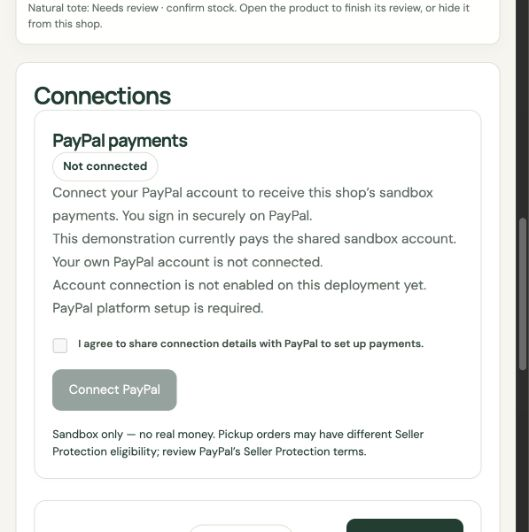

# Connect PayPal — seller onboarding

Updated experience and current verification: [Seller payments and simpler UI](SELLER_PAYMENTS_UI.md).

Implemented locally on 3 November 2026. **153 automated tests pass and the production build passes.** This includes ten new controlled PayPal connection tests. No new real PayPal seller authorization or marketplace transaction is claimed. This source release includes the connection implementation; hosted deployment and actual sandbox activation require separate verification.

## Seller experience

1. Sign in as a seller and select the shop.
2. Open **Settings → Connections → PayPal payments**.
3. Agree to share connection details and click **Connect PayPal**.
4. Sign in on PayPal and authorize payment/refund permissions.
5. Return to RestoreCart. The server looks up the seller using its own tracking ID and verifies merchant identity, confirmed email, payments receivable and grants for this platform client.
6. The panel shows **Connected · sandbox**, merchant ID and verification date. New orders pay that merchant.

If setup was incomplete or the browser return expired, finish setup on PayPal and use **I finished setup**. This uses authenticated server verification; a browser success flag never proves connection. A lost session can require signing in again. **Check connection** refreshes authorization status. **Disconnect this shop** stops new checkout; it does not move existing payments or revoke consent at PayPal. Full permission revocation is performed in the seller's PayPal account.

Connection is scoped to the selected shop and its authorized seller. Reconstructed or restored backup drafts do not inherit a PayPal authorization. Connect each shop deliberately.

## Deployment activation

The original private `.env` contains single-merchant checkout credentials; a separate private `.data/backend-verification.env` supplies sandbox Platform credentials. Test these in a separate workspace. If platform settings are missing, Connect PayPal opens a setup explanation. Ordinary checkout credentials alone do not establish a marketplace connection. Seller-connected checkout is the default. Shared demo checkout requires explicit `PAYPAL_ALLOW_SHARED_DEMO=true` and `PAYPAL_REQUIRE_SELLER_CONNECTION` not set to `true`.

Configure in server-only environment variables, never in chat or `VITE_*`:

| Variable | Required value |
| --- | --- |
| `PAYPAL_ENV` | `sandbox` |
| `PAYPAL_CLIENT_ID`, `PAYPAL_CLIENT_SECRET` | The sandbox Platform REST app's credentials, enabled for Partner Referrals |
| `PAYPAL_PARTNER_MERCHANT_ID` | That platform's PayPal merchant ID |
| `PAYPAL_PARTNER_ATTRIBUTION_ID` | Its PayPal attribution/BN code |
| `PAYPAL_WEBHOOK_ID` | Webhook registered to that app and this deployment's `/api/paypal/webhook` |
| `RESTORECART_BASE_URL` | The deployed HTTPS origin |
| `PAYPAL_REQUIRE_SELLER_CONNECTION` | Set `true` when operating only seller-connected checkout; refuses shared-demo fallback even if platform setup is missing |

Use PayPal Developer Dashboard → Apps & Credentials → Sandbox to create/configure a **Platform** app. Obtain the appropriate partner account/attribution information from PayPal's platform setup. Do not invent a BN code. PayPal documents sandbox testing before live approval; live operation requires platform approval and is outside RestoreCart's sandbox-only scope.

Subscribe to existing payment/refund events plus `MERCHANT.ONBOARDING.COMPLETED` and `MERCHANT.PARTNER-CONSENT.REVOKED`. Only signature-verified webhook events reach processing. Onboarding completion triggers API verification; consent revocation marks matching connections revoked and blocks new checkout. Fresh order creation rechecks authorization with PayPal, so a saved Connected label alone cannot authorize payment creation.

**Credential changes:** do not replace the original checkout app's credentials while it has unresolved shared-demo orders/refunds. Existing first-party orders are not converted into platform-delegated orders. Use a separate sandbox deployment/database for initial platform testing, or settle/export the old demonstration first and retain its credentials for its remaining operations. Connected-order snapshots retain the original merchant/platform/client/attribution. If platform/client credentials change, old delegated requests fail closed rather than using a different seller.

## Security and payment behavior

- Seller-only, shop-owner authorization; mutating routes require the existing CSRF protections.
- Random 256-bit callback state, hashed at rest, bound to seller, session, shop and connection generation, expires after 30 minutes and is consumed once.
- Return URL is server-generated; browser merchant IDs and consent/success flags are ignored for authorization.
- API calls use fixed PayPal sandbox endpoints. Redirects are accepted only on `https://www.sandbox.paypal.com`; no arbitrary endpoint, seller-entered merchant ID or seller secret is accepted.
- Explicit seller consent before referral creation; short restart throttling and expired callback cleanup.
- Server checks tracking identity, merchant identity, confirmed email, payments receivable and payment/refund scopes granted to the platform client.
- New checkout is blocked before stock reservation if connection is required but missing. Once connecting/disconnected/revoked, the shop cannot silently use the shared account.
- Each connected order snapshots its merchant context. Create, read, capture, refund and payment-event lookups use that context through `PayPal-Auth-Assertion` and attribution headers. Existing provider idempotency keys remain unchanged.
- Local disconnect stops new orders but existing delegated orders can finish using their original authorization, if PayPal still grants it. PayPal consent revocation can prevent further captures/refunds; funds remain with the original merchant and failed operations require reconciliation/reconnection, not account substitution.
- Connection records share the same database retention limits as orders. Default Render Free storage can reset; no durable hosting claim is added.

## Verification

`npm test` → **153 passed, zero failures/skips**. `npm run build` → passed, with existing vendor chunk-size warnings. [Test output](../../tests/evidence/restorecart-paypal-connect-tests.txt) · [Build output](../../tests/evidence/restorecart-paypal-connect-build.txt).

New [controlled tests](../../tests/restorecart-paypal-connections.test.ts) cover ownership/CSRF/consent, session-bound callback and replay prevention, forged success parameters, missing grants/email/payment eligibility, tracking and merchant mismatch, replaced/expired callbacks, off-site signup URLs, checkout/capture/refund merchant binding, revocation/client changes, explicit shared-demo behavior, actual authorization-header generation and pre-reservation checkout blocking. All provider responses and transactions in these tests are synthetic. No third-party credentials or money were used.

Browser verification used an isolated database with no API keys: seller sign-in → Settings → PayPal card. The visible Not connected status, disabled action and setup explanation were confirmed. The actual external consent journey remains pending platform configuration and a real sandbox test.

## Official references

- [Platform setup and sandbox eligibility](https://developer.paypal.com/platforms/get-started)
- [Seller onboarding before payment](https://developer.paypal.com/platforms/seller-onboarding/before-payment/)
- [Partner Referrals API](https://developer.paypal.com/api/partner-referrals/v2/)
- [Seller authorization headers for checkout](https://developer.paypal.com/platforms/checkout/standard/integrate)
