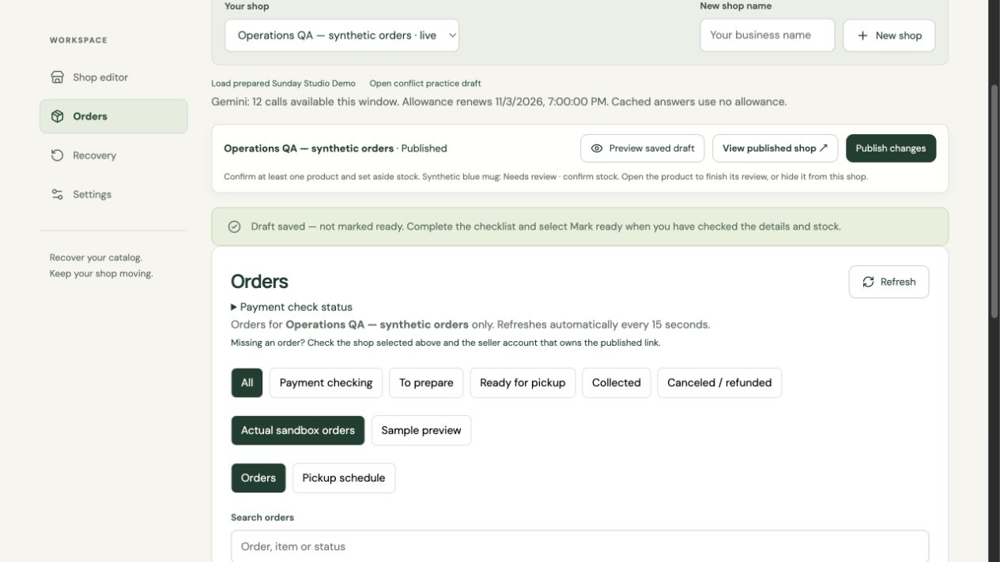
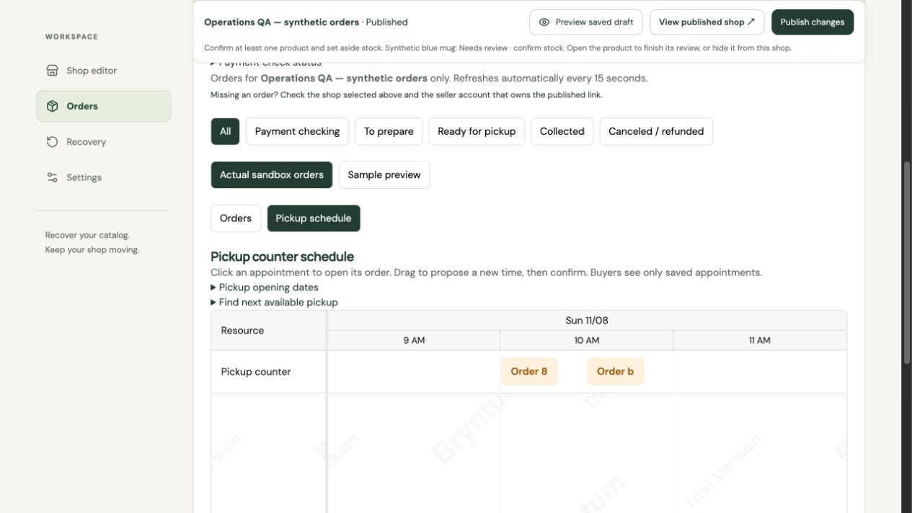
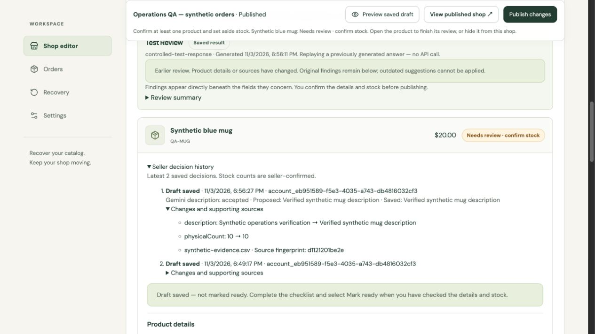

# Operational strengthening verification — 3 November 2026

Priorities **1, 2, 3, 6 and 7** are implemented locally. Priorities 4 and 5 were excluded as requested. The core demonstration journey is preserved. This report does not assert deployment of these changes or a guaranteed prize outcome.

## Automated results

- **143 tests passed; 0 failures, cancellations or skipped tests.** [Full output](../../tests/evidence/restorecart-strengthening-tests.txt)
- **6 focused AI validation scenarios passed.** [AI evaluation output](../../tests/evidence/restorecart-ai-evaluation.txt)
- **Production typecheck and build passed.** Existing optional vendor bundle-size warnings remain. [Build output](../../tests/evidence/restorecart-strengthening-build.txt)
- Reproduce with `npm test`, `npm run test:ai-evals`, `npm run build`.

The six AI scenarios inject controlled model responses and intercept the transport; no Gemini API call was made. They verify the application's validation and publication safeguards, not the probability that a real model will generate a particular answer. No model accuracy percentage is claimed.

| Case | Scenario | Observed result |
| --- | --- | --- |
| AI-E01 | Conflicting source prices | Conflict remains unresolved; a cited suggestion does not approve or mutate the product. |
| AI-E02 | Invented price or source ID | Unsupported suggestion withheld; seller clarification retained. |
| AI-E03 | Missing information | Missing data stays missing; no automatic approval. |
| AI-E04 | Ambiguous variant photo | Draft suggestion remains subject to seller review; no physical stock confirmation inferred. |
| AI-E05 | Malicious instructions inside uploaded records | Uploaded instructions stay in the data context; unauthorized response fields rejected. |
| AI-E06 | Unsupported image references and uncited claims | Invalid proposals withheld. |

These cases exercise specific defenses; they do not prove immunity to all prompt injection attacks. Test definitions: [strengthening tests](../../tests/restorecart-strengthening.test.ts).

## Seller decision history

Product saves append seller-attributed history within the same database transaction. Accepted, rejected and overridden proposals retain proposed/final values, model/review provenance, source names and hashes, and timestamps. Manual edits and stock assertions are recorded too. The server checks proposals against the saved review; forged or stale acceptances are rejected. A failed transaction leaves no partial audit entry. HTTP tests verify owner access, CSRF protection, revision checks and forbidden access by buyers/other sellers.

In the editor, choose **Use suggestion** or **Keep current value**, then save. Expand **Seller decision history**. History is not saved merely by clicking a suggestion. The UI shows the latest 100 entries per product. This is application audit history in the same database, not an externally immutable ledger; temporary storage retains its documented reset limits.

## Payment and inventory consistency

Added regression cases cover competing purchases of the last unit, repeated capture, a lost refund response retried with the same provider idempotency key, duplicate refund notifications and single stock restoration. Existing payment, reconciliation and duplicate-safe recovery tests remain passing. These tests use controlled payment transports, not new live PayPal transactions.

## AG Grid operational use

The order workspace offers All / Needs attention / To prepare / Unscheduled pickups, USD numeric filters, visible-row captured/refunded/net totals, filtered CSV export with spreadsheet-formula protection, reset and browser-session preferences. Captured totals require a confirmed capture; unpaid rows are not revenue. The existing global status filter still applies before these workspace filters.

Browser checks on an isolated synthetic database confirmed:

- Two synthetic paid orders total $60; Unscheduled initially selects one $40 order.
- Filtered CSV exports that one row with $40 captured and $40 net. [Synthetic CSV](../../tests/evidence/restorecart-strengthening-orders.csv) (BOM removed and line endings normalized for the repository)
- Total USD equals 20 selects the $20 order, rather than filtering cents.
- Leaving and reopening Orders retains the workspace preference; Reset restores All.

AG Grid Community is used; no AG Studio/Charts functionality or enterprise license is claimed. Sample examples remain separate and have no actual captured payments.

## Bryntum operational use

Actual eligible appointments can be dragged to propose a new time. The timeline retains the saved appointment until the seller explicitly confirms. Server checks reject overlaps, stale changes, ineligible orders and times outside configured opening windows. Click an event to open its order. Forms provide keyboard-accessible rescheduling and next-slot proposals. Buyer receipts read saved appointment updates.

Browser checks with synthetic orders confirmed:

- Actual Bryntum Scheduler Pro renders two saved events with its trial watermark.
- Dragging a 10:00 appointment to 10:30 opens a proposal; confirmation persists 10:30.
- Next available pickup proposes a free 10:00–10:20 slot for the other order; confirmation saves it.
- Attempting an overlapping move is rejected and the saved time remains unchanged.
- Saving an opening date works; reschedule fields refresh after a confirmed move.
- At 390px width the page has no horizontal overflow.

HTTP tests separately confirm buyer receipt synchronization and authorization. Offset timestamps normalize to UTC; equivalent expected times do not falsely trigger stale-edit rejection. Supported scheduling scope: one counter, one opening window per date, fixed shop time zone, no overnight or recurring windows. Sample appointments remain read-only. Evaluation licensing and the list fallback remain as documented in [Bryntum setup](BRYNTUM_SETUP.md).

## Evidence boundaries

The browser database, source records and orders were synthetic and isolated from the user's rehearsal database. The history screenshot uses a visibly labelled **controlled-test-response**, not a real Gemini output. No new live Gemini, PayPal or WooCommerce test was performed. Historical real sandbox evidence stays in its existing reports. These changes do not resolve free-host storage persistence or establish Bryntum trial entitlement.

[Mobile screenshot](../../tests/evidence/restorecart-strengthening-mobile.png). The existing recorded demo need not be rerecorded to show the same core flow; these additional controls are documented here rather than claimed as already present in that recording.
